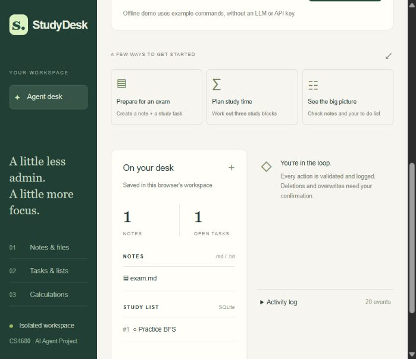

# StudyDesk Agent

A CS4680 AI Agent Project: turn a student's request into a reviewed plan that
performs real file, SQLite task, and arithmetic operations.

## Run locally

Requires **Python 3.11 or newer**. From this `assignment4` directory:

```powershell
python app.py
```

Open **http://127.0.0.1:8000**. No installation or API key is required for the
**Offline demo**. The default local server is intended for development.
For a threaded server, install the included dependency:

```powershell
python -m pip install -r requirements.txt
python app.py
```

The parent folder also contains unrelated earlier assignment files. All code
needed for this project is inside this directory.



## Try the offline demo

Choose **Offline demo**, paste a request, select **Build a plan**, review the
actions, then select **Execute plan**:

```text
Create note exam.md: Review search algorithms; Add task: Practice BFS; Calculate (45 + 15) * 3
```

This creates a note, saves a task in SQLite, and calculates **180 minutes**.
Try these follow-ups separately:

```text
Read note exam.md
List notes; List tasks
Complete task 1
Delete note exam.md
```

Use the actual task ID shown on your desk. Deletion and overwrite plans display
a confirmation checkbox. **Cancel** discards a plan without executing it.
Semicolons separate actions in offline mode; they cannot be used inside demo
note contents or task titles.

**Offline mode is a deterministic command parser, not an LLM.** It is useful
for trying the UI and executor without credentials. Enable OpenAI for the
assignment's real LLM integration and flexible natural language.

## Enable the real LLM

The backend uses OpenAI's Responses API with a strict JSON schema. The key is
read only from the server process environment, never from the browser.
In PowerShell, enter a key privately without echoing it:

```powershell
$studyDeskSecret = Read-Host 'OpenAI API key' -AsSecureString
$env:OPENAI_API_KEY = [System.Net.NetworkCredential]::new('', $studyDeskSecret).Password
$env:OPENAI_MODEL = 'gpt-4o-mini'
python app.py
```

Stop an already running server first with Ctrl+C. Refresh the page, select
**OpenAI**, and try:

> Prepare for my AI exam: make a note called review.md with a checklist for BFS,
> DFS, and A*, add a task to practice search algorithms, and calculate the time
> for three 45-minute sessions with two 10-minute breaks.

This sends the request and the current note filenames/task inventory to OpenAI.
Existing note bodies are not automatically sent. Model access and API billing
depend on your account; `OPENAI_MODEL` can be set to another Responses model
supporting Structured Outputs. Authentication errors are displayed without
exposing the key. Temporary HTTP 429, 5xx, and transport failures receive at
most three attempts, with bounded backoff/Retry-After delays.

The supplied `.env.example` documents settings; **the app does not load `.env`
files automatically**. Set environment variables in your shell or hosting UI.

## What the agent can do

| Domain | Tools | Concrete effect |
| --- | --- | --- |
| Files | `note.save`, `note.read`, `note.list`, `note.delete` | UTF-8 `.md`/`.txt` files in a session sandbox |
| Database | `task.add`, `task.list`, `task.complete`, `task.delete` | Parameterized SQLite statements |
| Computation | `calc.evaluate` | Bounded arithmetic using Python's AST; no `eval` |

Every plan is server-owned, expires in 15 minutes, and can execute once.
The browser sends a plan ID, rather than supplying executable actions. The
backend validates tool names, exact argument types, filenames, lengths, and
arithmetic before preview and again before execution. Changed overwrite risks
invalidate a preview. The executor rechecks confirmations on the server.

Actions execute sequentially and stop on the first error. Earlier successful
actions persist; the results explicitly report failure and skipped actions.
There is no automatic retry of execution and no cross-domain rollback.

## Architecture and source map

```text
Browser request
    -> /api/plan
    -> OpenAI planner OR explicitly selected offline parser
    -> validate allowlisted plan
    -> SQLite plan store -> user reviews and confirms
    -> /api/execute (plan ID only)
    -> risk recheck -> file / task / arithmetic executor
    -> structured results + SQLite audit -> refreshed browser
```

| File | Responsibility |
| --- | --- |
| `studydesk/llm.py` | Prompt, JSON schema, Responses client, retries, offline grammar |
| `studydesk/tools.py` | Plan validation, filename sandbox, arithmetic, allowlisted actions |
| `studydesk/service.py` | Session persistence, plan lifecycle, confirmation, audit |
| `studydesk/web.py` | WSGI routes, browser cookies, request checks, optional password |
| `studydesk/static/` | Responsive, accessible HTML/CSS/JavaScript interface |
| `tests/test_agent.py` | Backend integration, API contract, failure and safety tests |
| `docs/PROJECT_REPORT.md` | Problem, design decisions, prompting techniques, rubric map |
| `docs/DEMO_SCRIPT.md` | Timed 1–2 minute recording and submission guide |
| `docs/DEPLOYMENT.md` | GitHub, Render, Docker, configuration and smoke checks |

## Tests

```powershell
python -m unittest discover -s tests -v
node --check studydesk/static/app.js
```

Node is optional and only used for JavaScript syntax verification. Tests need
no API key or installed packages. API behavior is tested with mocked HTTP
responses; this does **not** prove a live paid API call. One filesystem test
skips when Windows does not permit symbolic links. See
`docs/VALIDATION.md` for the verification performed on this build.

Create a clean source archive with `python build_submission.py`. It writes
`submission/studydesk-assignment4.zip`, excluding private workspaces and caches.

## Storage and deployment boundaries

Data is stored under `data/<random-browser-session>/` by default. Each session
has a notes folder and SQLite database containing tasks, temporary plans, and
audit events. Cookies are HttpOnly and SameSite=Strict; HTTPS responses add
Secure. The current cookie lasts for the browser session. Clearing/losing it
creates a new workspace; existing data is not automatically recovered. This is
an educational sandbox, not a student identity system.

Audit records store action metadata and outcomes without copying note bodies
or API keys. Temporary saved plans **do contain their proposed content** and
live on the server; they are pruned on subsequent planning after one hour.
The activity panel shows the latest 50 audit events. Audit history is not
pruned. Local users/server administrators can inspect stored data.

Use a **single server process**, as confirmation and execution share an
in-process lock. Waitress provides multiple threads in that one process.
Do not use multiple replicas/workers on the same workspace. There is a limit
of 8 actions/plan, 100 notes/session, 500 tasks/session, 10 plans/minute/session,
60 plans/minute/process, and two simultaneous LLM requests. These limits are
for a classroom demo; they are not an internet-scale abuse or billing system.

Before hosting a live-key demo, set a strong `APP_PASSWORD`, use HTTPS, and
share the username `studydesk` and password privately with the evaluator.
Never commit API keys or user data. Free ephemeral hosting can lose all data
on restart/redeploy. Deployment and video publication remain user steps as
requested; there are no fabricated GitHub, hosted, or video URLs.

## References

- [OpenAI Structured Outputs](https://developers.openai.com/api/docs/guides/structured-outputs?api-mode=responses): Responses request/schema format.
- [Render deployment documentation](https://render.com/docs/your-first-deploy): service configuration and Git deployment.
- Assignment brief: **CS4680 Assignment 4 - AI Agent Project.pdf**, supplied by the user.
